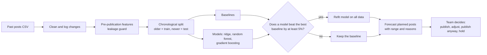

# Predicting Social Media Engagement Before You Post

Companion code for the paper **"Predicting Social Media Engagement Through Machine Learning: Evidence, Methods and Implications for Communications Practice"** by Ednah Rebeccah.

📄 **Read the full paper:** [on LinkedIn](https://www.linkedin.com/pulse/predicting-social-media-engagement-through-machine-ednah-rebeccah-g1cxf) · [PDF](paper/Predicting-Social-Media-Engagement.pdf)

This repository turns the paper's research design into a working, tested pipeline that a communications team can run on its own post history. It answers one narrow question honestly:

> Can information known **before** a post is published forecast its engagement within 48 hours more accurately than a simple "same as usual" rule?

If the answer is yes, the code saves a model that forecasts planned posts, gives each forecast a likely range, and explains the main reasons behind it in plain language. If the answer is no, it says so and recommends keeping the simple rule.

---

## The leaking cup

Every communications team pours effort into a cup: staff time, content, budget, and the stories of the people it works with. The cup leaks in two ways:

- **Lost impact**: effort that never reaches people.
- **Lost knowledge**: lessons that are never captured.

Most analytics measure the puddle on the table afterwards. This code is a tool for finding the leaks *before* the next pouring. It also repairs the knowledge leak: every run leaves a clean, documented record of what was planned, what was predicted and what happened.

The code also guards against a third, hidden crack, **data leakage**. That is when information from after publication seeps into a "pre-publication" model and makes it look far better in testing than it will ever be in real use. The pipeline refuses to run if that happens.

---

## Quick start

Requires Python 3.10 or newer.

```bash
git clone https://github.com/Ednah-Rebeccah/social-media-engagement-prediction.git
cd social-media-engagement-prediction
pip install -r requirements.txt

# 1. Create a synthetic demo dataset (invented numbers, for trying the pipeline)
python scripts/generate_sample_data.py

# 2. Run the full study: baselines vs models, tested on the most recent posts
python scripts/run_study.py --data data/sample_posts.csv --out outputs

# 3. Forecast posts you are planning to publish
python scripts/predict.py \
    --model outputs/model_bundle.joblib \
    --history data/sample_posts.csv \
    --planned data/sample_planned_posts.csv
```

Then open **`outputs/REPORT.md`**. It starts with the answer, in plain language.

Example forecast output (synthetic data):

| post_id | predicted_engagement_48h | likely_low | likely_high | main_reasons |
| --- | --- | --- | --- | --- |
| PLAN-01 | 145 | 74 | 317 | Platform = instagram (+40%); Audience size = 21,500 followers (+29%); Format = carousel (+28%); Topic = grant_call (+27%) |
| PLAN-03 | 22 | 11 | 49 | Topic = policy (-35%); Format = link (-31%); Audience size = 21,700 followers (+29%); Platform = linkedin (-13%) |

---

## Using your own data

1. Export post-level data from your platforms (Meta Business Suite, LinkedIn page analytics and similar). Use only accounts you are authorised to analyse.
2. Arrange it as one row per post, following **[`data/DATA_DICTIONARY.md`](data/DATA_DICTIONARY.md)**. The key columns are publication time, platform, account, format, topic, paid/organic, followers at the time of posting, caption, and engagement within 48 hours.
3. Adjust **[`src/engagement_model/config.py`](src/engagement_model/config.py)** if your column names, outcome or window differ. Every decision the paper asks you to make explicitly lives in that one file.
4. Run the study and read the report.

Expect to need several hundred posts with consistent records. With fewer, the honest result is usually that no model beats the baseline, and the report will say so.

---

## How the logic works



Each step corresponds to a section of the paper:

| Step | What the code does | Paper | Code |
| --- | --- | --- | --- |
| Define the outcome | Engagements within a fixed 48-hour window | 5.1 | `config.py` |
| Clean the data | Removes duplicates and impossible values, standardises labels, flags (but keeps) viral outliers, logs every change | 9.2 | `data.py` |
| Build features | Format, topic, platform, timing, audience size, simple caption features (length, hashtags, questions, calls to action, links) | 5, 6 | `features.py` |
| Account history | Median engagement of the account's last 20 posts, **counting only posts whose 48-hour window had already closed** | 5.2, 9.2 | `features.py` |
| Leakage guard | Stops the run if any post-publication column (reach, impressions, lifetime metrics) becomes a predictor | 5.2, 5.5 | `features.py` |
| Split in time | Oldest 80% trains, newest 20% tests; never random | 2.5, 8.4 | `split.py` |
| Baselines | Historical mean, historical median, and the account's recent median ("same as usual") | 8.3 | `models.py` |
| Models | Ridge regression, random forest, gradient boosting, all on log(1 + engagement) so viral posts do not dominate | 5.3, 7.1 | `models.py` |
| Evaluate | MAE, RMSE, R², MAPE on unseen posts, plus month-by-month rolling-origin testing | 8 | `evaluate.py` |
| Error analysis | MAE and bias by platform, format and topic | 9.4 | `evaluate.py` |
| Decision gate | A model is adopted only if it cuts MAE by at least 5% versus the best baseline | 8.3, 11.3 | `study.py` |
| Explain | Global: permutation importance. Local: exact contributions from the ridge model, shown as percentages | 7.4 to 7.6 | `explain.py` |
| Forecast | Point forecast plus an 80% likely range from real test-set errors | 8.6, 10.5 | `study.py` |

### Why these design choices

- **The baseline is "same as usual", not a straw man.** The account's own recent median is a strong forecast. A model that cannot beat it has not earned a place in planning.
- **Simple models first.** On the synthetic data, ridge regression usually matches or beats the tree ensembles. That is typical of small organisational datasets (paper, Section 4).
- **Forecasts are ranges.** Social media is noisy. The likely range comes from how wrong the model actually was on recent unseen posts.
- **Explanations are percentages, not jargon.** "Format = carousel (+28%)" means the model expects about 28% more engagement than for an otherwise similar post. It describes what the model learned from your history, **not** proof that switching format will cause that change. Test that deliberately (paper, Section 10.2).

---

## What you get in `outputs/`

| File | Contents |
| --- | --- |
| `REPORT.md` | Plain-language summary: the answer, cleaning log, results, stability, weak spots, important inputs |
| `holdout_results.csv` | Every baseline and model scored on the held-out recent posts |
| `rolling_origin_results.csv` | Month-by-month scores: is accuracy stable over time? |
| `error_by_group.csv` | Where forecasts are weakest (platform, format, topic) |
| `feature_importance.csv` | Which inputs the best model relies on |
| `predicted_vs_actual.png`, `rolling_origin_mae.png` | Charts for the report |
| `test_predictions.csv` | Actual vs predicted for every test post, every model |
| `model_bundle.joblib` | The chosen approach, refit on all data, for `predict.py` |
| `summary.json` | Headline numbers, machine-readable |

---

## What the synthetic demo shows

The sample data are **invented**, with known patterns built in (carousels and grant calls do better; policy statements and link posts do worse; a few posts go viral by chance). Running the pipeline on it illustrates two lessons from the paper:

- **With 700 posts** the models beat the best baseline by only about 4%, so the gate keeps the baseline.
- **With 1,200 posts** (the default) the ridge model beats it by about 10% and is adopted.

More consistent history, not a cleverer algorithm, is what made the difference. Do not quote any number from the synthetic data as evidence about real audiences.

---

## Limitations

- **Correlation, not causation.** The model learns patterns in your history. To know whether a change *causes* better results, run deliberate tests.
- **Typical, not total.** Models trained on log(engagement) forecast a *typical* outcome. They will under-predict the average because rare viral posts pull the average up. Do not sum forecasts to plan totals.
- **Drift.** Platforms, audiences and strategies change. Retrain at least quarterly and compare forecasts with outcomes (paper, Section 10.3).
- **Text features are simple and English-leaning.** The call-to-action word list in `features.py` should be extended with phrases your team uses, including in Luganda, Swahili or other languages.
- **Engagement is not impact.** A model that forecasts reactions well can still push a team towards content that scores well rather than content that matters (paper, Section 10.1). Choose the outcome that fits your purpose.

## Responsible use

- Use only data from accounts you are authorised to analyse, in line with platform terms and applicable law (for example Uganda's Data Protection and Privacy Act, 2019).
- The pipeline needs **no personal data about individual followers**. Keep it that way.
- Keep a **[model card](MODEL_CARD.md)** next to any model your team uses.
- Forecasts are prompts for a conversation, never decisions. Publish strategically important content regardless of its forecast.

---

## Optional: SHAP explanations for tree models

If you install [SHAP](https://github.com/shap/shap) (`pip install shap`), `explain.shap_contributions()` can explain random forest and gradient boosting forecasts directly. The default explanations use the ridge model and need no extra packages. The SHAP path is written but was not tested in the environment where this code was built.

## Running the tests

```bash
python -m unittest discover -s tests -v     # or: pytest
```

The tests check the safeguards the paper insists on:
- the worked example from Section 8.2 reproduces exactly (MAE 25 vs 10);
- post-publication columns are rejected;
- the history feature never uses future or unfinished posts;
- splits are strictly chronological;
- the full study and forecasting run end to end.

## Project structure

```
├── README.md
├── MODEL_CARD.md                  template to fill in for your team
├── paper/                         the full paper (PDF)
├── requirements.txt
├── data/DATA_DICTIONARY.md        expected columns
├── src/engagement_model/
│   ├── config.py                  every study decision in one place
│   ├── data.py                    load, validate, clean, log changes
│   ├── features.py                pre-publication features + leakage guard
│   ├── split.py                   chronological and rolling-origin splits
│   ├── models.py                  baselines and models
│   ├── evaluate.py                metrics, rolling evaluation, error analysis
│   ├── explain.py                 global and local explanations
│   ├── report.py                  charts and REPORT.md
│   └── study.py                   the full study and forecasting
├── scripts/
│   ├── generate_sample_data.py    synthetic demo data
│   ├── run_study.py               run the study
│   └── predict.py                 forecast planned posts
└── tests/test_pipeline.py
```

## Citation

If you use this code, please cite the accompanying paper:

> Rebeccah, E. (2026). *Predicting Social Media Engagement Through Machine Learning: Evidence, Methods and Implications for Communications Practice.* Published on LinkedIn: https://www.linkedin.com/pulse/predicting-social-media-engagement-through-machine-ednah-rebeccah-g1cxf ([PDF copy](paper/Predicting-Social-Media-Engagement.pdf)).

## Licence

Released under the MIT Licence. See [`LICENSE`](LICENSE).
